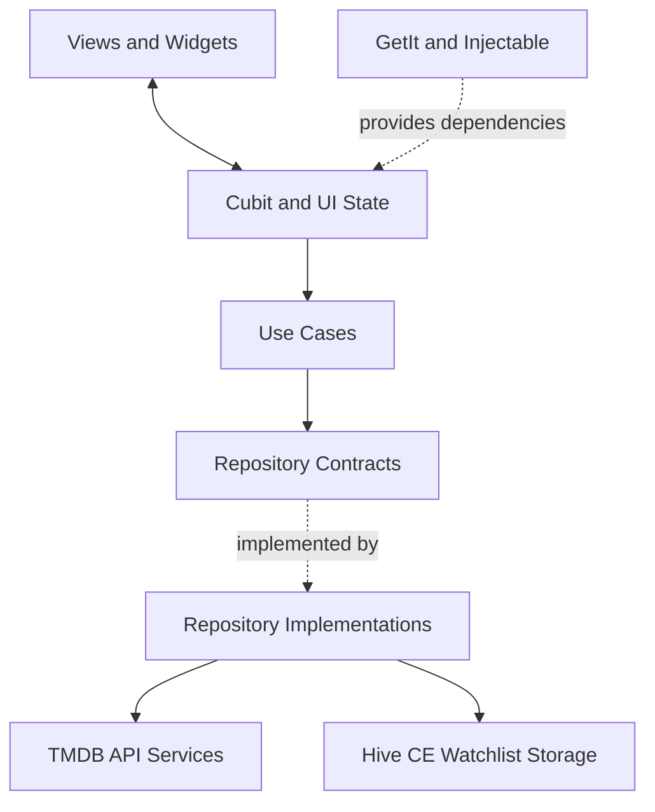

<div align="center">

# 🎬 Filmo

### Discover movies. Explore stories. Save what you love.

A Flutter movie discovery app powered by the [TMDB API](https://developer.themoviedb.org/docs), built around movie browsing, detailed film information, search, and a locally stored watchlist.

<br />

[](https://flutter.dev/)
[](https://dart.dev/)
[](https://pub.dev/packages/flutter_bloc)
[](https://www.themoviedb.org/)

<br />

**[▶ Watch the Filmo Demo](https://github.com/user-attachments/assets/7283ead6-492a-449c-9db4-437ed821ae94)**

</div>

---

## About

Filmo is a movie discovery application developed with Flutter as an NTI graduation project. It brings movie discovery, search, detailed film information, and a personal watchlist into one dark-themed interface.

The app retrieves movie data from TMDB and uses local storage to keep the watchlist available between app sessions. The codebase separates the main features into data, domain, and presentation responsibilities, with Cubit managing UI state.

## Features

* **Home:** Browse top-rated, popular, and upcoming movies.
* **Movie details:** View a film's overview, release information, runtime, genres, ratings, cast, and crew.
* **Similar movies:** Explore related titles from the details screen.
* **Search:** Search TMDB's movie catalogue, with loading, empty-result, and error states.
* **Watchlist:** Save and remove movies, with data persisted locally using Hive CE.
* **Onboarding:** Animated introduction with Skip/Continue controls and a saved completion state.
* **Navigation:** Floating bottom navigation that animates out of view while scrolling.
* **UI feedback:** Cached network images, shimmer loading, pull-to-refresh on Home, and empty/error states.

> **Current scope:** The separate Releases tab is currently a “Coming Soon” screen. Upcoming movies are already displayed in the Home feed.

## Tech Stack

| Area              | Technologies                                                              |
| ----------------- | ------------------------------------------------------------------------- |
| App development   | Flutter, Dart                                                             |
| State management  | Cubit / `flutter_bloc`                                                    |
| Architecture & DI | Feature-first structure, Clean Architecture principles, GetIt, Injectable |
| Networking        | HTTP, REST, TMDB API                                                      |
| Local persistence | Hive CE, SharedPreferences                                                |
| UI                | Material, Cached Network Image, Google Fonts, shimmer/loading animations  |
| Feedback          | Toastification                                                            |
| Developer tools   | Git, GitHub, Postman                                                      |

## Architecture

The main data-driven features—Home, Details, Search, and Watch List—are organized to separate presentation, business logic, and data access. Shared utilities and reusable components live in `core/`.



### Project structure

```text
lib/
├── main.dart
├── app_section/       # Main app shell and bottom navigation
├── core/              # Shared UI, networking, utilities, dialogs, DI
└── feature/
    ├── onboarding/    # Splash screen and onboarding flow
    ├── home/          # Popular, top-rated, and upcoming movies
    ├── details/       # Movie information, cast/crew, similar movies
    ├── search/        # Movie search and results
    ├── watch_list/    # Local watchlist feature
    ├── reels/         # Current placeholder screen
    └── menu_drawer/   # Side menu
```

## TMDB API

Filmo uses [The Movie Database (TMDB)](https://www.themoviedb.org/) for movie data.

| Purpose                   | Endpoint                                             |
| ------------------------- | ---------------------------------------------------- |
| Popular movies            | `GET /3/movie/popular`                               |
| Top-rated movies          | `GET /3/movie/top_rated`                             |
| Upcoming movies           | `GET /3/movie/upcoming`                              |
| Movie details and credits | `GET /3/movie/{movie_id}?append_to_response=credits` |
| Similar movies            | `GET /3/movie/{movie_id}/similar`                    |
| Search                    | `GET /3/search/movie?query={query}`                  |

Movie images are served from TMDB's image CDN. The app currently uses the `w500` image size for movie artwork.

## Getting Started

### Requirements

* Flutter SDK with a Dart version compatible with the constraint in `pubspec.yaml` (`^3.11.5`)
* Android Studio or VS Code
* TMDB API access

### Run locally

```bash
git clone YOUR_REPOSITORY_URL
cd YOUR_REPOSITORY_DIRECTORY
flutter pub get
flutter run
```

If you change classes annotated for dependency injection, regenerate the generated configuration when needed:

```bash
dart run build_runner build --delete-conflicting-outputs
```

### API key note

The provided source currently contains a TMDB API key directly in several API service files. Rotate that key and remove hard-coded credentials before making the repository public. A value embedded in a distributed Flutter app cannot be treated as a secret; `--dart-define` alone does not make it secure. Use a backend proxy if the credential must remain confidential.

## Team Project & My Role

Filmo was developed as a team project during NTI's Flutter Mobile Application Development training. I served as **Team Leader**, contributing to the project foundation and shared core setup, coordinating feature tasks and Git workflow, reviewing code, and helping integrate the team's work.

The project gave me practical experience in feature-based development, Cubit state management, dependency injection, API integration, local persistence, and applying Clean Architecture principles in a collaborative codebase.

## Acknowledgements

* Movie data and artwork are provided by [The Movie Database (TMDB)](https://www.themoviedb.org/).
* This product uses the TMDB API but is not endorsed or certified by TMDB.
* Built with [Flutter](https://flutter.dev/) and [Dart](https://dart.dev/).

---

<div align="center">

**Filmo · Built with Flutter**

</div>
