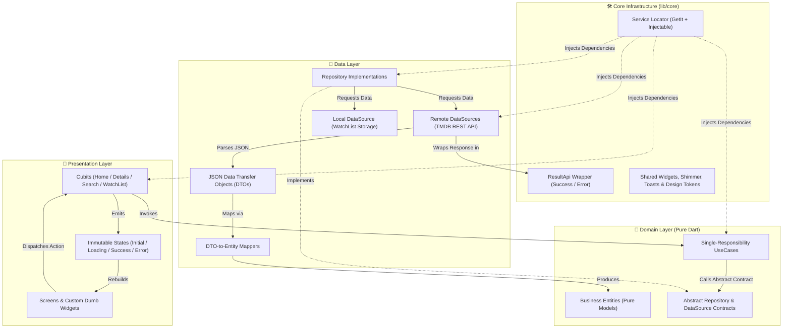
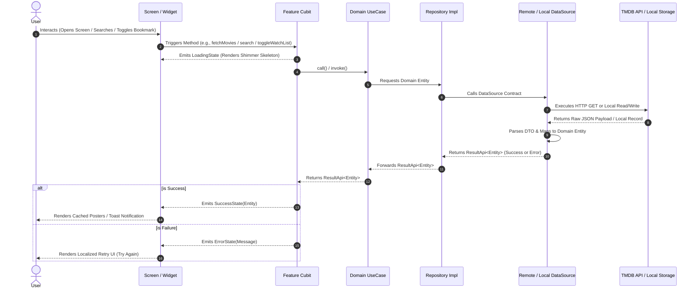

<div align="center">

  # 🎬 FILMO
  ### *Discover Cinema, Beautifully. Curate Midnight Retrospectives, and Never Lose Track Again.*

  <p align="center">
    An enterprise-grade, luxury-minimalist movie discovery, trailer streaming, and watchlist curation mobile application engineered with <b>Flutter</b>, <b>Feature-First Clean Architecture</b>, and <b>Cubit State Management</b>.
  </p>

  <!-- Tech Stack Badges -->
  <p align="center">
    <a href="https://flutter.dev"></a>
    <a href="https://dart.dev"></a>
    <a href="https://pub.dev/packages/flutter_bloc"></a>
    <a href="https://pub.dev/packages/get_it"></a>
    <a href="https://www.themoviedb.org/"></a>
    
  </p>

  <!-- Quick Navigation Links -->
  <h4>
    <a href="#-cinematic-product-demo">🎥 Watch Demo</a> •
    <a href="#-key-features--capabilities">🌟 Features</a> •
    <a href="#-design-system--luxury-ui-tokens">🎨 Design System</a> •
    <a href="#-system-architecture--data-flow">🏗️ Architecture</a> •
    <a href="#-project-directory-structure">📂 Folder Tree</a> •
    <a href="#-api-reference--postman-collection">🌐 API Docs</a> •
    <a href="#-engineering-team--agile-workflow">👥 Team & Workflow</a> •
    <a href="#-getting-started">⚡ Quick Start</a>
  </h4>

</div>

---

## 🎥 Cinematic Product Demo

> **90-Second Product Walkthrough:** Experience the complete user journey—from the 3D-styled onboarding and shimmer-backed discovery rails to real-time search, resilient error boundaries, and swipeable local watchlist persistence.

https://github.com/user-attachments/assets/7283ead6-492a-449c-9db4-437ed821ae94

---

## 🌟 Key Features & Capabilities

| Feature Module | User Experience & Engineering Implementation |
| :--- | :--- |
| **🎞️ Splash & Onboarding** | • Editorial typography with smooth page indicators (`onboarding_screen.dart` & `onboarding_page.dart`).<br>• Custom animated transitions introducing core app pillars: *Discover Cinema*, *Swipe Through Reels*, and *Build Your Watch List*. |
| **🏠 Dynamic Home Hub** | • **3 Concurrent Data Streams:** Parallel fetching of *Recommended* (`/movie/top_rated`), *Popular* (`/movie/popular`), and *Releases* (`/movie/upcoming`).<br>• **Dynamic Header Animation:** Rotating tagline banners (`YOUR NEXT FAVORITE`, `TONIGHT IS FOR CINEMA`, `A WORLD OF STORIES`) via `home_top_animation.dart`.<br>• **Perceived Performance:** Custom skeleton shimmer loaders (`home_loading_shimmer.dart`) and disk-cached network images (`cache_networkImage_widget.dart`). |
| **🎭 Film Details & Credits** | • **Comprehensive Metadata:** High-res backdrops, taglines, release year, runtime in minutes, IMDb/TMDB ratings, and narrative synopsis (`movie_hero_section.dart`, `movie_information_section.dart`).<br>• **Cast & Crew Rails:** Dedicated horizontal lists for *Featured Cast* and *Production Crew* (`cast_crew_section.dart`, `cast_crew_item.dart`).<br>• **Curated Recommendations:** *More Like This* horizontal rail (`similar_movies_section.dart`) with isolated error-retry boundaries (`show_error_ui.dart`). |
| **🔍 Real-Time Smart Search** | • Instant keyword querying (`/search/movie`) with live result counters (`search_screen.dart`).<br>• **Resilient Empty States:** Custom empty/invalid search screen (`invalid_search_screen.dart`) with one-tap search reset (`Clear Search`). |
| **🔖 Offline Watch List** | • **Local Persistence:** Instant bookmark toggling across Home, Details, and Search screens via `watch_list_local_data_source.dart` and `watch_list_storage.dart`.<br>• **Interactive Gestures:** Smooth swipe-left-to-remove cards (`watch_list_movie_card.dart`), contextual toast banners (`app_toasts.dart`), and a dedicated empty collection view. |
| **📱 Reels & Shell Navigation** | • Floating pill-shaped bottom navigation bar (`app_section_view.dart`), vertical short trailers view (`reels_screen.dart`), and side navigation drawer (`menu_drawer_screen.dart`). |

---

## 🎨 Design System & Luxury UI Tokens

**Filmo** is built around a **"Minimalist Luxury Cinema"** visual identity (`lib/core/utils/app_colors.dart`), pairing deep obsidian backgrounds with warm champagne gold accents for maximum contrast and zero visual fatigue.

| Token Role | Swatch | Color / Specification | Application Across UI |
| :--- | :---: | :--- | :--- |
| **Primary Background** | `⬛` | `#0D0F12` *(Obsidian Dark)* | Main scaffold background, splash screen, and immersive frames |
| **Elevated Surface** | `⬛` | `#16181D` *(Charcoal Slate)* | Movie cards, search input field, floating bottom navigation bar |
| **Luxury Primary Accent** | `🟨` | `#D4BC8B` *(Champagne Gold)* | Primary CTA buttons, active bookmark icons, rating badges |
| **Semantic Feedback** | `🟩` / `🟥` | `#2E7D32` / `#E53935` | Watchlist confirmation toast banners & swipe-to-delete backgrounds |
| **Spatial Grid & Geometry** | `📐` | **8px Grid & Squircles** | Continuous rounded corners (`16px–24px`) and structured 8px spacing |

---

## 🏗️ System Architecture & Data Flow

To lead a **4-developer engineering team** with zero merge conflicts and strict separation of concerns, the project implements **Feature-First Clean Architecture** combined with **Cubit (BLoC)** and **Automated Dependency Injection (`GetIt` + `Injectable`)**.

### 1. High-Level Architectural Blueprint



### 2. End-to-End Request Lifecycle (Sequence Diagram)



### 3. Core Engineering Principles Applied
* **DTO-to-Entity Isolation:** Raw API models (`popolure_movie_dto.dart`, `recommended_movie_dto.dart`, `releases_movie_dto.dart`, `details_dto.dart`) are strictly confined to the `data/` layer. Dedicated mappers (`lib/feature/home/data/mapper/`) convert DTOs into pure Domain Entities before reaching any Cubit or Widget.
* **Unified `ResultApi<T>` Pattern:** All asynchronous operations are wrapped in `lib/core/network/result_api.dart`, eliminating uncaught exceptions and enabling independent UI error recovery (e.g., if `DetailsApi` fails, the `SimilarMoviesSection` still loads seamlessly).
* **Service Locator DI (`service_locatore.dart` & `service_locatore.config.dart`):** Constructor injection across DataSources, Repositories, UseCases, and Cubits ensures high testability and modular decoupling.

---

## 📂 Project Directory Structure

```text
lib/
├── main.dart                                              # Application entry point & DI initialization
├── app_section/
│   └── app_section_view.dart                              # Main shell hosting floating bottom navigation bar
├── core/
│   ├── common/
│   │   ├── app_bar.dart                                   # Standardized custom AppBar
│   │   ├── custem_action_bookmark_icon .dart              # Reusable reactive bookmark toggle icon
│   │   ├── custem_action_menu.dart                        # Contextual action menu component
│   │   └── search_bar.dart                                # Shared debounced search input bar
│   ├── di/
│   │   ├── service_locatore.dart                          # GetIt & Injectable setup
│   │   └── service_locatore.config.dart                   # Auto-generated dependency graph
│   ├── dialogs/
│   │   ├── app_toasts.dart                                # Custom toast banners (Watchlist feedback)
│   │   ├── show_error_ui.dart                             # Reusable error boundary with retry action
│   │   └── show_loading.dart                              # Modal loading indicators
│   ├── network/
│   │   └── result_api.dart                                # Sealed ResultApi<T> wrapper (Success / Failure)
│   ├── utils/
│   │   ├── api_constant.dart                              # Base URLs, endpoints & TMDB configuration
│   │   ├── app_colors.dart                                # Luxury dark & champagne gold color tokens
│   │   ├── assets_icons.dart                              # Centralized SVG / icon path constants
│   │   └── assets_image.dart                              # Centralized image asset constants
│   └── widgets/
│       ├── cache_networkImage_widget.dart                 # Cached network image with fallback & placeholder
│       └── loading_shimmer.widget.dart                    # Global skeleton shimmer effect
└── feature/
    ├── onboarding/
    │   ├── data/onboarding_data.dart                      # Static onboarding slides content
    │   └── presentation/
    │       ├── splash_screen.dart                         # Animated Filmo brand splash screen
    │       ├── onboarding_screen.dart                     # PageView controller & skip/continue logic
    │       └── widgets/                                   # OnboardingPage & OnboardingButton
    ├── home/
    │   ├── data/
    │   │   ├── api/                                       # Popular, Recommended & Releases API services
    │   │   ├── mapper/                                    # DTO-to-Entity mappers for all 3 home rails
    │   │   ├── model/                                     # Popolure, Recommended & Releases DTOs
    │   │   └── repo/                                      # Remote DataSources & Repository implementations
    │   ├── domain/
    │   │   ├── entity/home_movie_entity.dart              # Unified HomeMovieEntity
    │   │   ├── repo/                                      # Abstract DataSource & Repository interfaces
    │   │   └── use_case/                                  # GetPopolure, GetRecommended & GetReleases UseCases
    │   └── presentation/
    │       ├── view/home_screen.dart                      # Main discovery dashboard screen
    │       ├── view_model/                                # HomeCubit & HomeState
    │       └── widget/                                    # HomeMovieCard, Recommended carousel, Shimmer & TopAnimation
    ├── details/
    │   ├── data/
    │   │   ├── api/details_api.dart                       # Movie details & similar movies endpoints
    │   │   ├── model/                                     # DetailsDto & SimilarDto
    │   │   └── repo/                                      # DetailsDataSourceImp & DetailsRepositoryImp
    │   ├── domain/
    │   │   ├── entities/                                  # DetailsEntity & SimilarEntity
    │   │   ├── repo/                                      # Abstract Details contracts
    │   │   └── use_case/                                  # GetDetailsUseCase & GetSimilarUseCase
    │   └── presentation/
    │       ├── view/screens/details_movie_screen.dart     # Film Detail screen
    │       ├── view/widgets/                              # Hero, Synopsis, Info, Cast/Crew & Similar Movie widgets
    │       └── view_model/                                # DetailsCubit & DetailsState
    ├── search/
    │   ├── data/
    │   │   ├── api/home_search_api.dart                   # Search endpoint client
    │   │   ├── models/movie_model.dart                    # Search response JSON model
    │   │   └── repo/search_repository_imp.dart            # Search repository implementation
    │   ├── domain/
    │   │   ├── entities/movie_entity.dart                 # Search MovieEntity
    │   │   ├── repo/search_repository.dart                # Abstract search contract
    │   │   └── use_case/search_movies_use_case.dart       # SearchMoviesUseCase
    │   └── presentation/
    │       ├── view/screen/                               # SearchScreen & InvalidSearchScreen
    │       ├── view/widget/movie_item.dart                # Search result card item
    │       └── view_model/cubit/                          # SearchCubit & SearchState
    ├── watch_list/
    │   ├── data/
    │   │   ├── data_sources/watch_list_local_data_source.dart
    │   │   ├── models/watch_list_movie_model.dart
    │   │   ├── repositories/watch_list_repository_impl.dart
    │   │   └── watch_list_storage.dart                    # Local persistence engine
    │   ├── domain/
    │   │   ├── entities/watch_list_movie_entity.dart
    │   │   ├── repositories/watch_list_repository.dart
    │   │   └── use_cases/                                 # Get, Remove & Toggle WatchList UseCases
    │   └── presentation/
    │       ├── view/watch_list.dart                       # Watch List screen & empty state
    │       ├── view/widgets/watch_list_movie_card.dart    # Swipeable dismissible movie card
    │       └── view_model/                                # WatchListCubit & WatchListState
    ├── reels/
    │   └── reels_screen.dart                              # Short vertical movie trailers feed
    └── menu_drawer/
        └── view/menu_drawer_screen .dart                  # Side navigation drawer
```

---

## 🌐 API Reference & Postman Collection

All remote cinema data is powered by **The Movie Database (TMDB) REST API v3**. A complete Postman collection (`Movies App.postman_collection.json`) is included in the repository root for instant endpoint testing.

| Module | Method | Endpoint | Description |
| :--- | :---: | :--- | :--- |
| **Home — Popular** | `GET` | `/3/movie/popular` | Fetches trending and currently popular movies |
| **Home — Recommended** | `GET` | `/3/movie/top_rated` | Fetches highest-rated films for the primary hero carousel |
| **Home — Releases** | `GET` | `/3/movie/upcoming` | Fetches upcoming theatrical releases |
| **Movie Details** | `GET` | `/3/movie/{movie_id}` | Retrieves full metadata, runtime, genres, synopsis, and credits |
| **Similar Movies** | `GET` | `/3/movie/{movie_id}/similar` | Retrieves curated "More Like This" film recommendations |
| **Movie Search** | `GET` | `/3/search/movie?query={query}` | Queries movies in real time by title keyword |
| **TMDB Image CDN** | `GET` | `https://image.tmdb.org/t/p/w500/{poster_path}` | Base prefix for serving optimized movie posters and backdrops |

---

## 👥 Engineering Team & Agile Workflow

This project was delivered by a **4-person Flutter engineering team**. As **Team Leader**, the workflow was structured to maximize parallel development velocity while maintaining strict code quality:

1. **Core Foundation First:** Engineered the `core/` architecture (`ResultApi`, `ServiceLocator` DI, `AppColors`, `CacheNetworkImageWidget`, `LoadingShimmer`, and `AppToasts`) and finalized Postman API contracts prior to feature branching.
2. **Vertical Feature Slicing:** Divided the application into independent vertical modules (`Home`, `Details`, `Search`, `WatchList & Onboarding`). Each developer owned their feature across `Data` ➔ `Domain` ➔ `Presentation`, preventing cross-team blocking and merge conflicts.
3. **Contract-Driven Development:** Defined abstract Domain Entities and Repository interfaces early so UI screens and API integrations could progress simultaneously.
4. **Pull Request Governance:** Enforced strict code reviews ensuring zero DTO leakage into the UI, single-responsibility UseCases, and consistent shimmer/error handling across all screens.

### 👨‍💻 Team Roster

| Role | Engineer | Ownership & Contributions |
| :--- | :--- | :--- |
| **Team Leader & Lead Flutter Engineer** | **Abdallrahman Mohamed Zidan** | System Architecture, Core Module & DI Setup, Workflow Management, PR Code Reviews, Feature Integration & UI Polish |
| **Flutter Software Engineer** | **[Team Member 2 Name]** | End-to-End Feature Architecture & Cubit State Management |
| **Flutter Software Engineer** | **[Team Member 3 Name]** | End-to-End Feature Architecture & Cubit State Management |
| **Flutter Software Engineer** | **[Team Member 4 Name]** | End-to-End Feature Architecture & Cubit State Management |

---

## ⚡ Getting Started

### Prerequisites
* **Flutter SDK:** `>=3.0.0`
* **Dart SDK:** `>=3.0.0`
* A valid **TMDB API Key** from [The Movie Database](https://www.themoviedb.org/documentation/api)

### Installation & Execution

```bash
# 1. Clone the repository
git clone [https://github.com/your-username/filmo.git](https://github.com/your-username/filmo.git)
cd filmo

# 2. Fetch project dependencies
flutter pub get

# 3. Generate Dependency Injection configuration (if modifying annotated classes)
dart run build_runner build --delete-conflicting-outputs

# 4. Run the application
flutter run
```

> **🔒 Security Note:** Before pushing to a public repository, ensure your personal TMDB `api_key` in `lib/core/utils/api_constant.dart` and `Movies App.postman_collection.json` is replaced with an environment variable or placeholder (`YOUR_TMDB_API_KEY`).

---

<div align="center">
  <b>If you found this architecture or UI design inspiring, please consider giving the repository a ⭐!</b><br>
  <sub>Architected and led with precision by <b>Abdallrahman Mohamed Zidan</b> & the <b>Filmo Engineering Team</b>.</sub>
</div>
